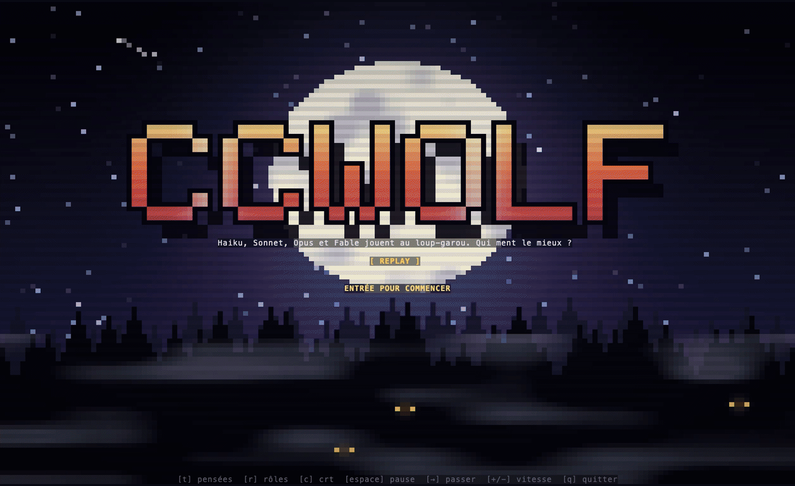

# ccwolf

Werewolf in the terminal, played by Claude models. Eight players around a campfire: two each of
Haiku 5.5, Sonnet 5.5, Opus 5.5 and Fable 5.1. Two of them are werewolves, and they have to lie
to the others all game long. You watch what each one says out loud and, next to it, what their
character really thinks.

Does a bigger model lie better? Run a few games and see.



[Version française](README.fr.md)

## Try it without a key

```sh
cargo install --git https://github.com/pcangemi/ccwolf
ccwolf --demo
```

`--demo` replays a recorded game, so it needs no API key and costs nothing. Add `--lang fr` for
the French one.

## Play a new game

```sh
export ANTHROPIC_API_KEY=sk-ant-...
ccwolf                 # 2 x Haiku, Sonnet, Opus, Fable, in your locale's language
ccwolf --lang en       # or --lang fr
ccwolf --lineup haiku  # eight Haiku, the cheapest game
```

A mixed game costs about $0.80, most of it for Fable. An all-Haiku game costs about $0.02.
The running cost is shown at the top of the screen. `--effort low` makes the models think less,
for a cheaper and faster game.

## The lie detector (optional)

With a [TypeSafe](https://typesafe.ai) key, every public speech goes to Jev, a model that answers
typed questions in a fraction of a second. Jev gets the speaker's real role, what they privately
know and what they just said, and returns how likely the speech is a lie, how convincing it
sounds, the role it claims and the player it accuses. The gauge fills under the speech once it is
typed, and the accused player lights up in the village.

```sh
export TYPESAFE_API_KEY=...
ccwolf jev-check        # three sample speeches: a lying wolf, a real seer, an honest villager
ccwolf judge FILE...    # add verdicts to games you recorded without Jev
```

Without the key, the game runs the same, without the gauge.

## What you see

- **The village** in pixel art: day and night, stars, fog, a campfire, lit windows. At night the
  werewolves show their true face and their eyes glow.
- **The speech** of the current player, and next to it **the aside**: their character's inner
  monologue, which no other player hears. The wolf swears they are a simple baker while their
  aside plans who to accuse.
- **The chronicle** of the game, and **the players** with their model and role.
- **The votes** as bars, the eliminations, the last words, the night's victims.

Keys: `t` asides, `r` roles, `c` CRT filter, `space` pause, `right` skip, `+` `-` speed, `q` quit.

## Who lies best

Every game is recorded in `~/.ccwolf/games`. `ccwolf stats` reads them and prints, for each
model: how often its wolves win, how often they get caught, how often its villagers vote against
a real wolf, and, with Jev, how much its wolves lie and how convincing they sound.

```sh
ccwolf --headless --games 10   # play 10 games without the screen
ccwolf stats
```

## How it works

- A deterministic narrator runs the game: night, wolves' council, seer, witch, dawn, two rounds of
  speeches, vote, last words. The models are only players.
- Each model sees its own role card and what was said in public, nothing else. The werewolves
  also hear each other at night, the seer gets her visions, the witch learns who was attacked.
- Each answer is JSON with a fixed schema (an aside, then a speech, a target or the witch's
  potions), so votes and night actions are never guessed from prose.
- The conversation of each player is cached, so a game mostly pays for new tokens.
- Games are seeded and recorded as JSONL; `--replay FILE` plays one again.

The rules are the classic party game (Mafia, 1986, and its werewolf variants), with two
werewolves, a seer, a witch and four villagers. ccwolf is not affiliated with any publisher.

## Privacy

ccwolf reads your keys from the environment and never writes them anywhere. The game text goes
to Anthropic, and to TypeSafe if you set its key. Recordings stay on your machine.

## Next

- Take a seat yourself and try to fool seven models.
- More players at the table: Mistral, OpenAI, OpenRouter, and local models through Ollama.

## License

MIT or Apache-2.0, at your option.
